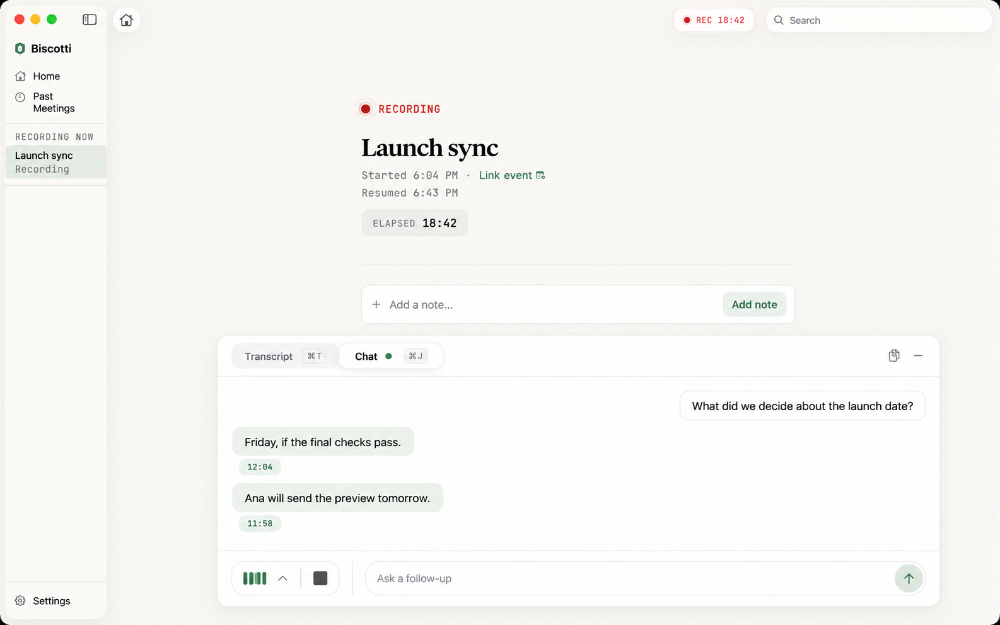
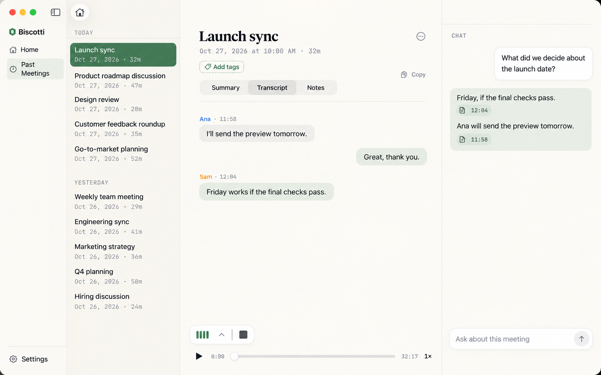
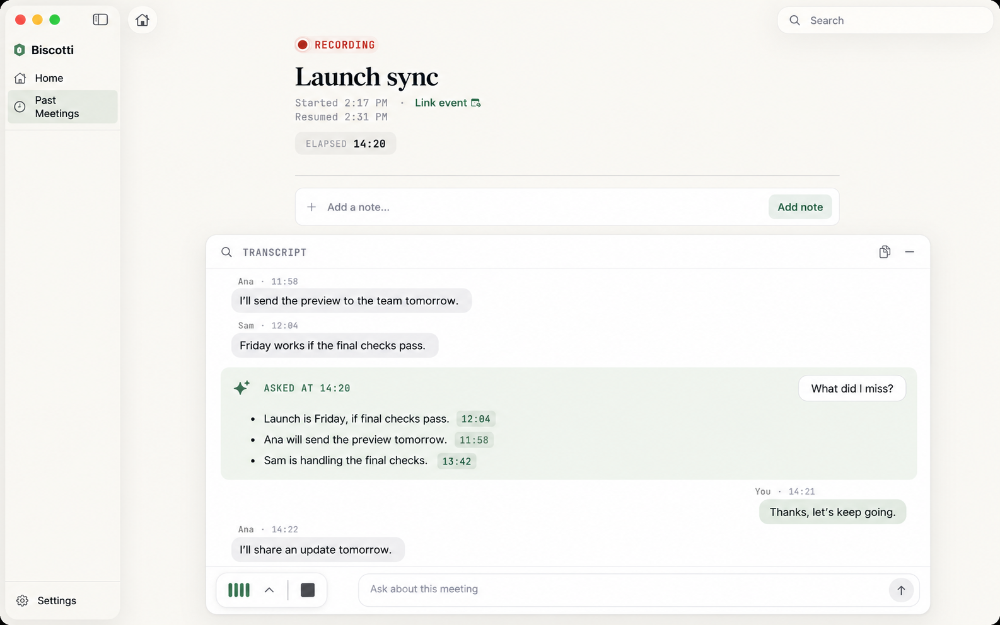
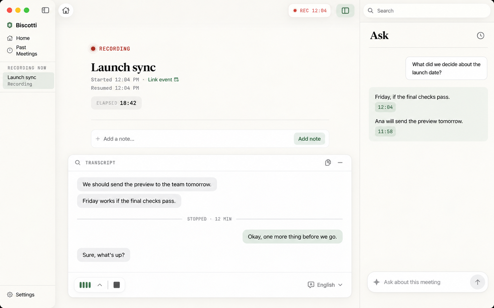
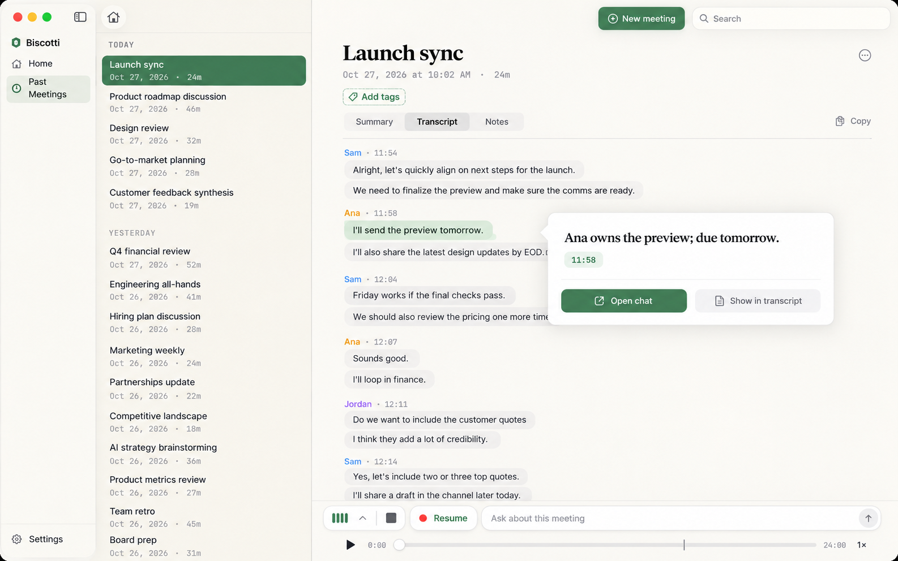
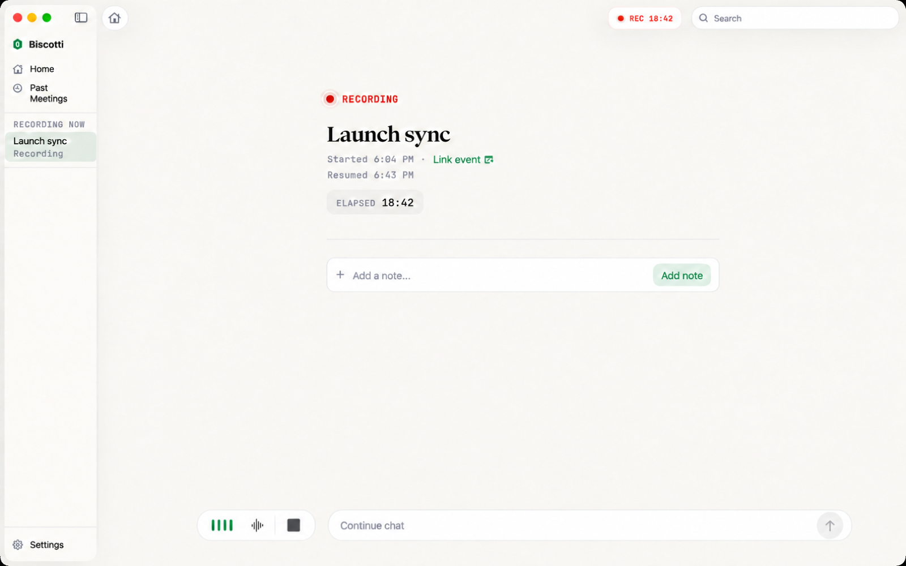
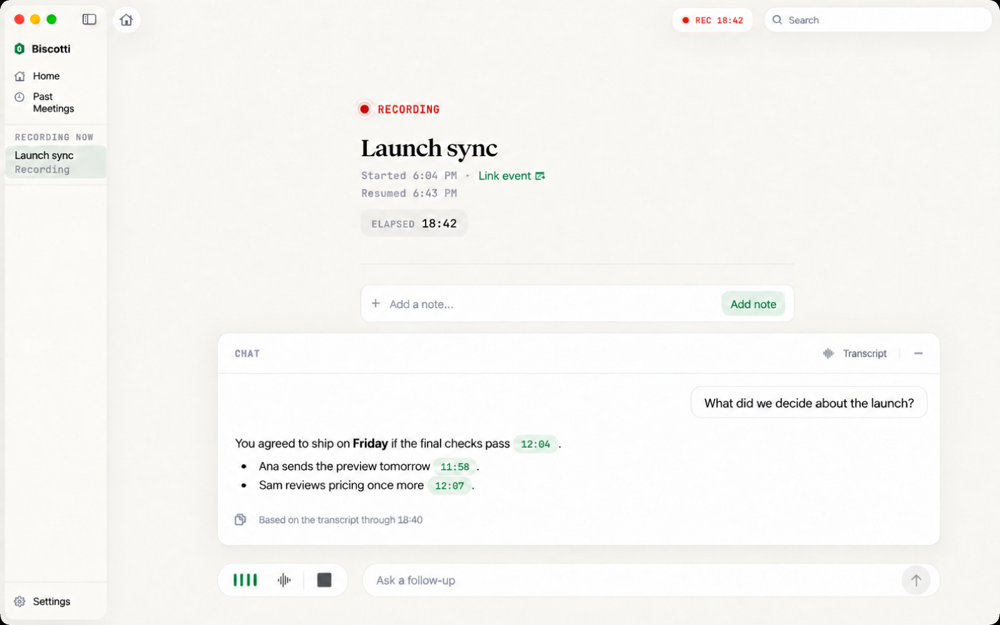
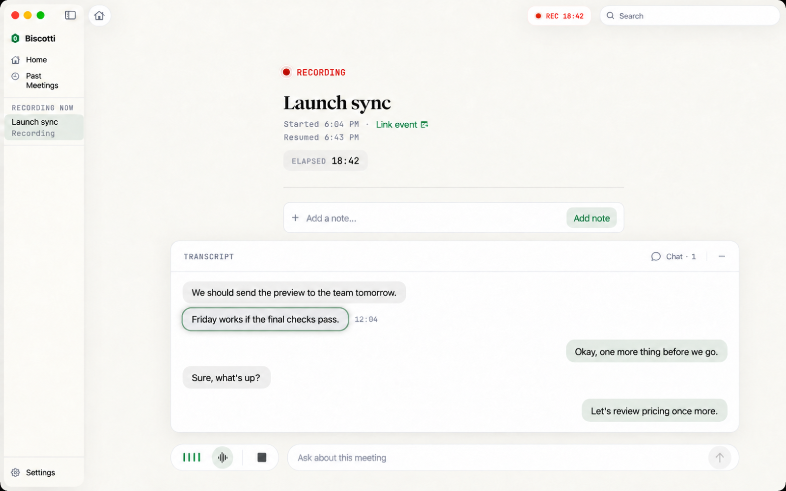
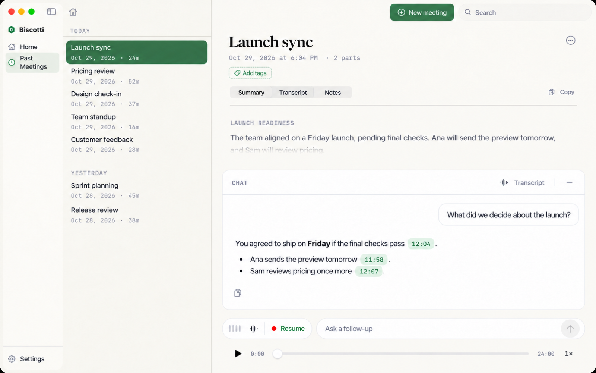

# Switching between the transcript and chat

Research and five alternatives, 29 October 2026. Design only: nothing here is built. The chosen concept goes into the meeting_chat backlog (phase 11).

**Recommendation:** concept 6, the fixed bar with one card (added after review of concept 1's mockup). Concept 2 (side by side) is a later option for the meeting page on wide windows.

## Today's design and where it breaks

Sources: [ui_design.md](../../ui_design.md), [components/chat_ui.md](../../components/chat_ui.md), `MeetingChatUI/ChatPlacement.swift`.

**Recording screen.** One bottom slot holds either the transcript drawer or the chat card, never both (`bottomSlot`: `.collapsed`, `.transcript`, `.chat`). The level-meter chevron opens the transcript and closes the chat. Closing the drawer shows the field again, and the field reopens the chat. A time chip in an answer closes the chat and opens the drawer at that time. While the drawer was opened from a chip, a "Back to chat" pill shows in its header.

**Meeting page.** The field sits above the playback bar on every tab. The chat card rises from it and covers the lower 60% of the page. A time chip switches to the Transcript tab and highlights the line in the 40% above the card.

Where it breaks down:

1. **No visible switch.** Chat and transcript share a slot, but nothing names both. The way to the transcript is a chevron on the level meter. The way back is a field that appears only after you close the drawer.
2. **You cannot ask while reading the transcript.** With the drawer open, its footer has the language menu, not the field. To ask, close the drawer first.
3. **"Back to chat" works only once.** It appears only after a chip, so a manual switch has no way back except the field.
4. **Checking a citation loses the answer.** On the recording screen the chip replaces the answer with the transcript, so the answer and its source are never on screen together.
5. **The two screens behave differently.** The recording screen swaps the slot. The meeting page overlays a card on top of the tab. The same chip does two different things.
6. **The meeting-flow pill crowds the row.** The meter pill becomes about twice as wide (Stop/Resume), so the field shrinks, and the field is the only way into chat.

## How other apps do it

| App | During the meeting | After | Switch | Citations |
|---|---|---|---|---|
| Granola | "Ask anything" bar at the bottom of the note; waveform button left of it toggles the transcript panel | Same bar; Ask Granola also as a sidebar | Bar always visible, transcript is a toggle | None found |
| Google AI Edge Foresight (the "Forsight" product; offline Mac app, Gemma on device, Oct 2026) | Not confirmed | Ask the assistant over the full transcript | Not confirmed | Not confirmed |
| Otter.ai | AI Chat during the call, shared with teammates; "what did I miss?" | Chat across meetings | Chat beside the transcript (not confirmed) | Not confirmed |
| Fireflies (AskFred) | Live Assist panel, needs the bot | AskFred beside the Notepad's transcript panel | Side by side | None confirmed |
| Fathom (Ask Fathom) | Not confirmed | Ask about a meeting or the library | Not confirmed | Answers carry timestamps that jump to the moment (G2 praise) |
| tl;dv | None found | Ask from the search bar; report lists timestamps | Search bar → report | Timestamps |
| Notion AI Meeting Notes | Notes / Transcript tabs | Same; Ask AI per page | Tabs | Summary citations: hover shows the line, click jumps to it |
| Zoom AI Companion | Right-side panel, prompts like "Catch me up" | Summary after the meeting | Side panel | No |

Patterns:

1. Chat is always reachable (a fixed bar or panel). The transcript is the secondary view that you toggle, except in Notion, where both are tabs.
2. During a call, the main questions are "catch me up" and "what did I miss", answered from the transcript so far.
3. Answers that cite and jump to the transcript get the clearest praise (Fathom, Notion, tl;dv).
4. Nobody hides chat while the transcript is open.
5. Keyboard shortcuts are rare and inconsistent (Granola's docs disagree between ⌘J and ⌘S).

Sources: [Granola transcription](https://docs.granola.ai/help-center/taking-notes/transcription), [Ask Granola](https://help.granola.ai/article/chatting-with-your-meetings-ask-granola), [Granola power-user tips](https://www.granola.ai/docs/docs/101/afteryourmeeting/power-user-tips), [tl;dv on Granola](https://tldv.io/blog/granola-review), [Windows Report on Foresight](https://windowsreport.com/google-foresight-is-a-new-local-ai-note-taking-app-that-works-offline/), [Let's Data Science on Foresight](https://letsdatascience.com/news/google-releases-ai-edge-foresight-an-offline-meeting-compani-638edbca), [TechCrunch on Otter AI Chat](https://techcrunch.com/2023/06/21/otter-is-introducing-a-meeting-oriented-ai-chatbot), [VentureBeat on Otter](https://venturebeat.com/ai/otter-ai-chat-brings-new-collaboration-and-insight-to-real-time-voice-transcription), [AskFred guide](https://guide.fireflies.ai/articles/6556345325-askfred-ask-fred-questions-from-your-meetings-in-fireflies-and-get-answers), [Fireflies during a meeting](https://guide.fireflies.ai/articles/3499406277-how-to-use-fireflies-during-a-meeting), [Fathom G2 reviews](https://g2.com/products/fathom-video/reviews_and_filters?page=4), [Zapier on tl;dv](https://zapier.com/blog/tldv-features/), [Notion AI meeting notes](https://www.notion.com/en-gb/help/ai-meeting-notes), [Zoom AI Companion (UW-Madison KB)](https://kb.wisc.edu/helpdesk/139097). Claims marked "not confirmed" come from third-party reviews or were not found.

## Five alternatives

All five keep today's chat card internals (bubbles, time chips, History, footnote) and the meeting-flow meter pill. They differ in where chat lives relative to the transcript.

### 1. Tabbed bottom card

The bottom card gets a segmented control, "Transcript | Chat", in its header where the "TRANSCRIPT" label is now. One card, one height, two named views. The footer always holds the meter pill and the question field, on both tabs, so you can ask from the transcript; sending switches to Chat. On the meeting page the same card rises from the field over any tab.

- **Switching:** click the segment; ⌘T and ⌘J select the tab (and open the card); Esc or the minus closes it. A sage dot on "Chat" marks an answer that finished while you were on Transcript. A time chip switches to Transcript and highlights the line; a "Back to chat" pill shows until you switch.
- **Pros:** both views are named and always one click apart; the field never disappears; the smallest change to today's code (`bottomSlot` becomes a tab inside one card). Matches Notion's tabs and Granola's always-present bar.
- **Cons:** you still cannot see an answer and its source at the same time.
- **Meeting flow:** the meter pill stays at the footer's left on both tabs, so Stop/Resume never moves. The fast-final progress ("Final transcript 62% · 1 min left") fits as a small line under the Transcript segment.

### 2. Side by side

On the meeting page's Transcript tab, the content splits into the transcript (left) and a chat column (right, about 340 pt) with its own field. On the recording screen, the bottom card splits the same way when the window is wider than about 1,100 pt, and falls back to concept 1's tabs when narrower.

- **Switching:** none needed when wide. A time chip scrolls the left column and highlights the line; the answer stays in view. ⌘J focuses the chat field.
- **Pros:** answer and source together (the main citation complaint goes away); like Fireflies' AskFred beside the transcript.
- **Cons:** needs width; the recording screen's centered notes column fights for space; two layouts to build and test.
- **Meeting flow:** the meter pill stays in the bottom row under the transcript column. Progress shows in the transcript column's header.

### 3. Answers in the timeline

Chat turns are part of the transcript: each question and answer appears as a distinct card in the transcript at the moment you asked ("ASKED AT 14:20"). There is no separate chat view; the field always sits in the transcript card's footer.

- **Switching:** none. Chips scroll within the same list. A filter ("All · Transcript · Questions") hides one or the other.
- **Pros:** one place; the answer is anchored in time, which suits "what did I miss"; after the meeting, you see what you asked and when.
- **Cons:** while recording, new speech pushes the answer up and away (needs a pin); long answers break up the transcript; it mixes your private questions into the meeting record, which matters for export and copy.
- **Meeting flow:** fits the divider rows (STOPPED · 12 MIN) naturally. The final transcript replacing live rows must keep the answer cards at their times.

### 4. Chat inspector

Chat moves to a macOS inspector on the window's right (full height, about 360 pt), toggled by a toolbar button and ⌘J. The bottom slot belongs to the transcript only. On the meeting page the inspector sits beside all tabs.

- **Switching:** no switching; both are open at once. A chip opens the drawer (or the Transcript tab) and highlights the line while the inspector stays.
- **Pros:** standard Mac pattern (Xcode, Pages, Zoom's right panel); answer and source together on every screen size above the window minimum; frees the bottom row for the meter pill.
- **Cons:** the biggest layout change; the recording screen is narrower with the inspector open; the bottom-row field goes away, so asking needs the toolbar button or ⌘J.
- **Meeting flow:** the meter pill gets the whole bottom row, so Stop/Resume and progress have room.

### 5. Answer peek

The transcript stays the main view. A question's answer appears in a compact popover above the field (about 520 × 180 pt), with "Show in transcript" and "Open chat". The cited line glows behind it. "Open chat" expands to today's full card for follow-ups and history.

- **Switching:** the popover dismisses on Esc or a click outside; ⌘J reopens the last answer. Chips highlight the line behind the popover.
- **Pros:** quick questions never leave the transcript; answer and source on screen together; light.
- **Cons:** two chat surfaces (peek and full card); long answers do not fit; streaming text in a popover that may grow is awkward.
- **Meeting flow:** the meter pill stays left of the field ("Resume" on a stopped meeting). The popover must not cover the progress line.

### 6. Fixed bar, one card (recommended)

| Closed | Chat | Transcript (cited line) | Meeting page |
|---|---|---|---|
|  |  |  |  |

Granola's model, with today's gaps fixed. A bottom bar sits outside the card and never changes: the meter pill (level bars, a transcript toggle, then Stop or Resume) and the question field. The card above it shows whichever view you used last. There is no tab control: you ask, or you look.

Why concept 1's mockup looked wrong, and what this one changes:

- **Chat must not look like the transcript.** Transcript lines stay bubbles. Questions are small white outlined bubbles; answers are plain document text on the card, with time chips inside the sentences. You can tell the view at a glance.
- **A quiet header instead of a segmented control.** Left: the view's name ("CHAT", "TRANSCRIPT") in the existing mono label style. Right: a small text button for the other view ("Transcript", or "Chat · 1" with the number of turns). No shortcut hints on screen; ⌘T and ⌘J live in the View menu.
- **The bar is outside the card**, so the card has one toolbar (its header), not two.
- **A cited line keeps its speaker colour** and gets a sage ring, so it never looks like a "You" bubble.

Switching:

- The waveform button in the meter pill opens and closes the transcript (pressed while shown). Clicking or typing in the field, or ⌘J, shows the chat. The header's text button goes to the other view. Minus closes the card; the bar stays.
- A time chip shows the transcript and rings the cited line for 2 s; the header button ("Chat · 1") is the way back, so the separate "Back to chat" pill goes away.
- On the meeting page the card rises from the bar over any tab. "Transcript" in its header switches the page to the Transcript tab and closes the card.

Pros: the field is always visible; the toggle is a real button; one behaviour on both screens; close to today's `bottomSlot` code. Cons: answer and source are still not on screen at the same time.

Meeting flow: the bar is the meter pill's home in every state, so Stop and Resume never move. The fast-final progress line fits in the transcript header ("TRANSCRIPT · finishing 62%").

Mockups needed three rounds: the first had a heavy meter pill and a saved-meeting answer footer that should not be there; the second had enabled send buttons on empty fields and a cited line drawn in the "You" colour.

## Comparison

| | Answer + source together | Ask from transcript | Change to today | Meeting-flow fit |
|---|---|---|---|---|
| 1 Tabbed card | No (one click) | Yes | Small | Good |
| 2 Side by side | Yes (wide only) | Yes | Medium | Good |
| 3 Timeline | Yes | Yes | Large | Good, but final pass must keep cards |
| 4 Inspector | Yes | Yes (⌘J) | Large | Best |
| 5 Peek | Yes (short answers) | Yes | Medium | Good |
| 6 Fixed bar | No (one click) | Yes | Small | Best (bar is fixed) |

Concept 6 fixes problems 1, 2, 3, 5 and 6 with the least code and keeps one model on both screens. Problem 4 (answer and source at once) stays; concept 2 can add it later on the meeting page.

Mockups were generated with Codex image generation from the B2 and B4 meeting-flow mockups as style references. They are illustrations; this text wins where they differ.
